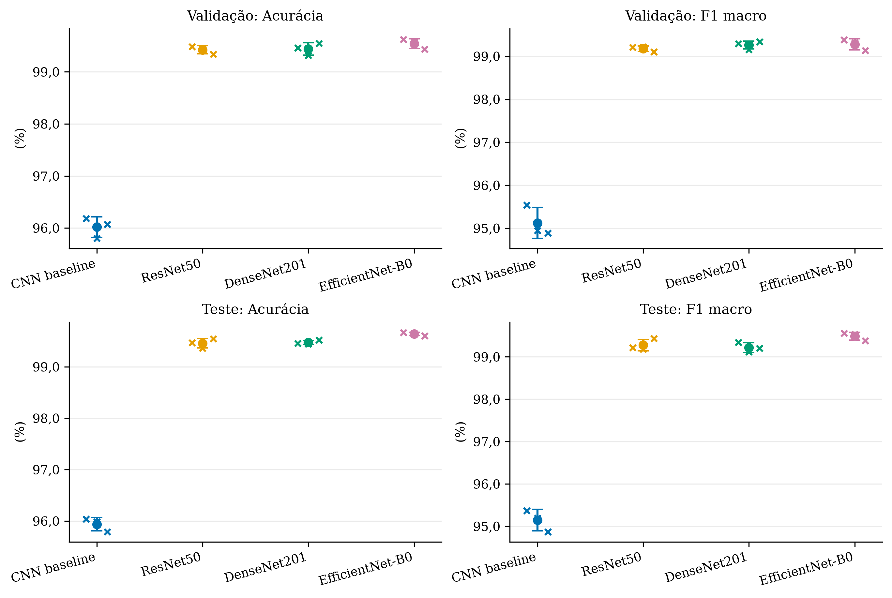
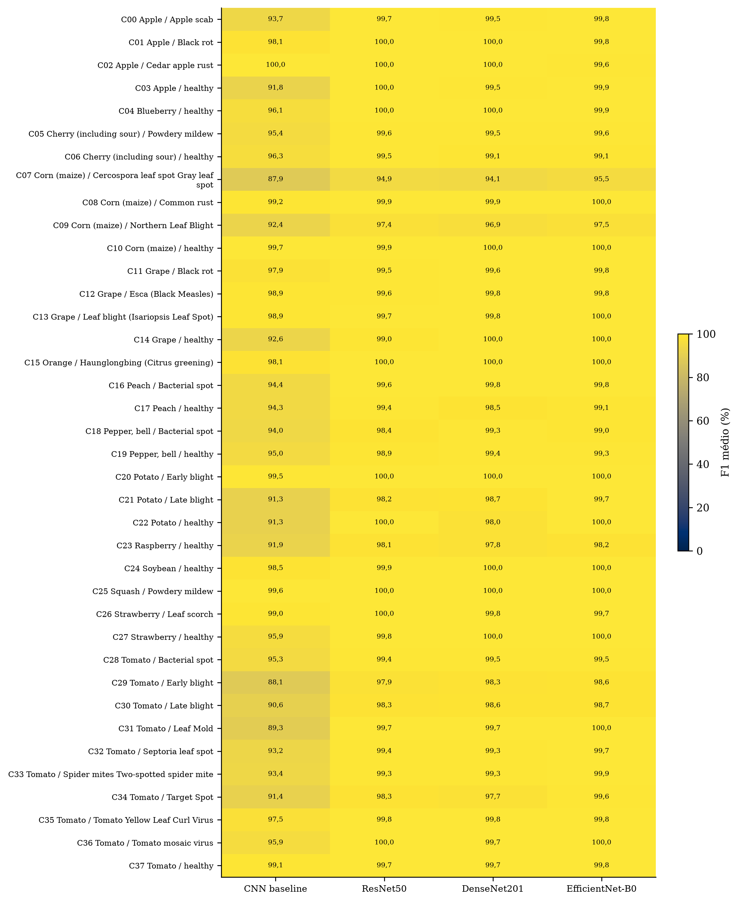
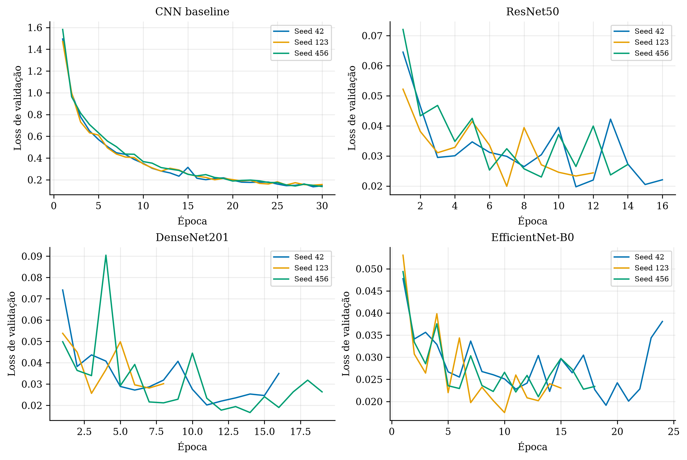
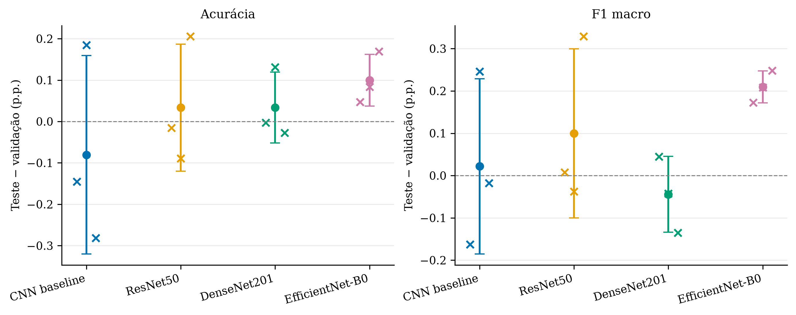

# Resultados e discussão: base empírica para o TCC2

## Escopo e método de análise

Foram analisados exclusivamente CSVs e JSONs de resultados já salvos. Nenhum modelo foi carregado, treinado ou executado. As predições existentes foram usadas para conferir matrizes e métricas, sem nova inferência. São quatro arquiteturas, três sementes (42, 123 e 456), 8.172 imagens de validação e 8.125 de teste, com 38 classes.

As médias são aritméticas entre sementes. O desvio padrão é amostral, com ddof=1 e n=3. Nas tabelas percentuais, os desvios são expressos na mesma escala, em pontos percentuais. Não representam intervalos de confiança nem incerteza sobre uma população de imagens. As mesmas imagens são usadas nas três sementes, portanto não há 24.375 observações de teste independentes.

Os checkpoints foram fixados pela menor loss de validação antes do teste, conforme o manifesto final. A comparação de teste é descritiva: não seleciona arquitetura, hiperparâmetros ou checkpoint. Não foi realizado teste inferencial de superioridade estatística.

## Resultados de validação

| Modelo | Acurácia (%) | Precisão macro (%) | Recall macro (%) | F1 macro (%) | Precisão pond. (%) | Recall pond. (%) | F1 pond. (%) |
| --- | --- | --- | --- | --- | --- | --- | --- |
| CNN baseline | 96,019 ± 0,195 | 95,424 ± 0,186 | 95,084 ± 0,693 | 95,124 ± 0,358 | 96,131 ± 0,219 | 96,019 ± 0,195 | 96,000 ± 0,204 |
| ResNet50 | 99,425 ± 0,076 | 99,162 ± 0,082 | 99,208 ± 0,140 | 99,178 ± 0,064 | 99,431 ± 0,079 | 99,425 ± 0,076 | 99,424 ± 0,077 |
| DenseNet201 | 99,441 ± 0,118 | 99,216 ± 0,116 | 99,322 ± 0,099 | 99,264 ± 0,093 | 99,448 ± 0,116 | 99,441 ± 0,118 | 99,442 ± 0,117 |
| EfficientNet-B0 | 99,543 ± 0,095 | 99,215 ± 0,138 | 99,365 ± 0,116 | 99,280 ± 0,130 | 99,553 ± 0,085 | 99,543 ± 0,095 | 99,544 ± 0,094 |

## Resultados finais de teste

| Modelo | Acurácia (%) | Precisão macro (%) | Recall macro (%) | F1 macro (%) | Precisão pond. (%) | Recall pond. (%) | F1 pond. (%) |
| --- | --- | --- | --- | --- | --- | --- | --- |
| CNN baseline | 95,938 ± 0,130 | 95,253 ± 0,132 | 95,236 ± 0,423 | 95,146 ± 0,254 | 96,070 ± 0,147 | 95,938 ± 0,130 | 95,928 ± 0,135 |
| ResNet50 | 99,458 ± 0,093 | 99,312 ± 0,223 | 99,259 ± 0,109 | 99,278 ± 0,136 | 99,466 ± 0,091 | 99,458 ± 0,093 | 99,458 ± 0,091 |
| DenseNet201 | 99,475 ± 0,040 | 99,216 ± 0,129 | 99,238 ± 0,097 | 99,220 ± 0,113 | 99,480 ± 0,041 | 99,475 ± 0,040 | 99,474 ± 0,040 |
| EfficientNet-B0 | 99,643 ± 0,033 | 99,491 ± 0,192 | 99,505 ± 0,021 | 99,490 ± 0,094 | 99,651 ± 0,024 | 99,643 ± 0,033 | 99,643 ± 0,031 |

### Interpretação dos resultados globais

- **CNN baseline:** acurácia de 95,938 ± 0,130% e F1 macro de 95,146 ± 0,254%. A diferença média teste − validação foi -0,080 p.p. em acurácia e 0,022 p.p. em F1 macro. O F1 ponderado excedeu o macro em 0,782 p.p., indicando que a agregação pelo suporte favorece classes mais frequentes com maior desempenho.
- **ResNet50:** acurácia de 99,458 ± 0,093% e F1 macro de 99,278 ± 0,136%. A diferença média teste − validação foi 0,034 p.p. em acurácia e 0,100 p.p. em F1 macro. O F1 ponderado excedeu o macro em 0,180 p.p., indicando que a agregação pelo suporte favorece classes mais frequentes com maior desempenho.
- **DenseNet201:** acurácia de 99,475 ± 0,040% e F1 macro de 99,220 ± 0,113%. A diferença média teste − validação foi 0,034 p.p. em acurácia e -0,044 p.p. em F1 macro. O F1 ponderado excedeu o macro em 0,255 p.p., indicando que a agregação pelo suporte favorece classes mais frequentes com maior desempenho.
- **EfficientNet-B0:** acurácia de 99,643 ± 0,033% e F1 macro de 99,490 ± 0,094%. A diferença média teste − validação foi 0,100 p.p. em acurácia e 0,210 p.p. em F1 macro. O F1 ponderado excedeu o macro em 0,153 p.p., indicando que a agregação pelo suporte favorece classes mais frequentes com maior desempenho.

A maior média observada de acurácia foi a de EfficientNet-B0, e a maior média observada de F1 macro foi a de EfficientNet-B0. Isso descreve esta divisão fixa e estas três sementes, sem demonstrar superioridade estatística ou justificar nova seleção pelo teste.

DenseNet201 − ResNet50 correspondeu a 0,016 p.p. de acurácia e -0,058 p.p. de F1 macro. A ordenação depende da métrica. A acurácia é influenciada pelo suporte das classes, enquanto o F1 macro dá igual peso a cada classe. O recall ponderado coincide com a acurácia neste problema de classificação multiclasse com um rótulo por imagem, por identidade matemática, não como evidência independente.

As diferenças entre validação e teste não indicam isoladamente sobreajuste: os conjuntos são distintos, com composição e suporte próprios, e a validação foi usada para escolher a época. Nenhum intervalo de confiança ou valor-p é inferido das barras de desvio padrão.

## Dificuldades de classificação e suporte

O suporte de teste varia de 24 imagens (Potato___healthy) a 824 (Orange___Haunglongbing_(Citrus_greening)), razão de 34,33 entre extremos. Há 3834 leaf_id distintos no teste. Imagens da mesma folha podem permanecer correlacionadas dentro do split. A tabela class_support.csv fornece imagens, folhas distintas e a variação de recall causada por um único erro por classe.

### CNN baseline: cinco menores F1 médios de teste

| Classe | n | Precisão (%) | Recall (%) | F1 (%) |
| --- | --- | --- | --- | --- |
| Corn_(maize)___Cercospora_leaf_spot Gray_leaf_spot | 77 | 86,59 ± 5,00 | 89,61 ± 4,68 | 87,91 ± 1,61 |
| Tomato___Early_blight | 149 | 97,86 ± 2,03 | 80,09 ± 1,69 | 88,07 ± 0,94 |
| Tomato___Leaf_Mold | 144 | 84,98 ± 6,67 | 94,21 ± 0,80 | 89,25 ± 3,39 |
| Tomato___Late_blight | 286 | 89,92 ± 2,30 | 91,49 ± 4,05 | 90,63 ± 1,00 |
| Potato___healthy | 24 | 88,67 ± 6,04 | 94,44 ± 2,41 | 91,34 ± 1,98 |

Principais confusões direcionais por contagem média:

| Classe real | Classe predita | Erros/execução | Taxa origem (%) | n origem | Seeds com erro |
| --- | --- | --- | --- | --- | --- |
| Tomato___Septoria_leaf_spot | Tomato___Leaf_Mold | 20,67 ± 12,86 | 7,80 ± 4,85 | 265 | 3 |
| Tomato___Tomato_Yellow_Leaf_Curl_Virus | Tomato___Bacterial_spot | 15,00 ± 16,52 | 1,87 ± 2,06 | 803 | 3 |
| Tomato___Tomato_Yellow_Leaf_Curl_Virus | Orange___Haunglongbing_(Citrus_greening) | 13,00 ± 19,05 | 1,62 ± 2,37 | 803 | 3 |
| Potato___Late_blight | Tomato___Late_blight | 11,67 ± 2,52 | 7,88 ± 1,70 | 148 | 3 |
| Tomato___Early_blight | Tomato___Late_blight | 10,67 ± 4,16 | 7,16 ± 2,79 | 149 | 3 |

### ResNet50: cinco menores F1 médios de teste

| Classe | n | Precisão (%) | Recall (%) | F1 (%) |
| --- | --- | --- | --- | --- |
| Corn_(maize)___Cercospora_leaf_spot Gray_leaf_spot | 77 | 96,95 ± 3,17 | 93,07 ± 3,27 | 94,92 ± 1,70 |
| Corn_(maize)___Northern_Leaf_Blight | 148 | 96,49 ± 1,58 | 98,42 ± 1,70 | 97,44 ± 0,84 |
| Tomato___Early_blight | 149 | 98,21 ± 1,36 | 97,54 ± 0,77 | 97,87 ± 0,69 |
| Raspberry___healthy | 55 | 98,76 ± 1,07 | 97,58 ± 4,20 | 98,14 ± 2,48 |
| Potato___Late_blight | 148 | 100,00 ± 0,00 | 96,40 ± 0,78 | 98,16 ± 0,40 |

Principais confusões direcionais por contagem média:

| Classe real | Classe predita | Erros/execução | Taxa origem (%) | n origem | Seeds com erro |
| --- | --- | --- | --- | --- | --- |
| Corn_(maize)___Cercospora_leaf_spot Gray_leaf_spot | Corn_(maize)___Northern_Leaf_Blight | 5,33 ± 2,52 | 6,93 ± 3,27 | 77 | 3 |
| Pepper,_bell___healthy | Pepper,_bell___Bacterial_spot | 4,33 ± 2,08 | 1,95 ± 0,94 | 222 | 3 |
| Potato___Late_blight | Tomato___Late_blight | 3,67 ± 1,15 | 2,48 ± 0,78 | 148 | 3 |
| Tomato___Early_blight | Tomato___Late_blight | 2,67 ± 0,58 | 1,79 ± 0,39 | 149 | 3 |
| Corn_(maize)___Northern_Leaf_Blight | Corn_(maize)___Cercospora_leaf_spot Gray_leaf_spot | 2,33 ± 2,52 | 1,58 ± 1,70 | 148 | 2 |

### DenseNet201: cinco menores F1 médios de teste

| Classe | n | Precisão (%) | Recall (%) | F1 (%) |
| --- | --- | --- | --- | --- |
| Corn_(maize)___Cercospora_leaf_spot Gray_leaf_spot | 77 | 94,35 ± 1,47 | 93,94 ± 1,50 | 94,14 ± 1,31 |
| Corn_(maize)___Northern_Leaf_Blight | 148 | 96,64 ± 1,13 | 97,07 ± 0,78 | 96,86 ± 0,84 |
| Tomato___Target_Spot | 210 | 99,02 ± 0,49 | 96,35 ± 1,92 | 97,66 ± 1,11 |
| Raspberry___healthy | 55 | 100,00 ± 0,00 | 95,76 ± 4,58 | 97,80 ± 2,40 |
| Potato___healthy | 24 | 96,10 ± 3,85 | 100,00 ± 0,00 | 97,99 ± 2,00 |

Principais confusões direcionais por contagem média:

| Classe real | Classe predita | Erros/execução | Taxa origem (%) | n origem | Seeds com erro |
| --- | --- | --- | --- | --- | --- |
| Corn_(maize)___Cercospora_leaf_spot Gray_leaf_spot | Corn_(maize)___Northern_Leaf_Blight | 4,67 ± 1,15 | 6,06 ± 1,50 | 77 | 3 |
| Corn_(maize)___Northern_Leaf_Blight | Corn_(maize)___Cercospora_leaf_spot Gray_leaf_spot | 4,33 ± 1,15 | 2,93 ± 0,78 | 148 | 3 |
| Tomato___Target_Spot | Tomato___Septoria_leaf_spot | 3,33 ± 1,53 | 1,59 ± 0,73 | 210 | 3 |
| Potato___Late_blight | Tomato___Late_blight | 3,00 ± 1,73 | 2,03 ± 1,17 | 148 | 3 |
| Tomato___Target_Spot | Tomato___Spider_mites Two-spotted_spider_mite | 3,00 ± 2,65 | 1,43 ± 1,26 | 210 | 2 |

### EfficientNet-B0: cinco menores F1 médios de teste

| Classe | n | Precisão (%) | Recall (%) | F1 (%) |
| --- | --- | --- | --- | --- |
| Corn_(maize)___Cercospora_leaf_spot Gray_leaf_spot | 77 | 95,28 ± 6,02 | 96,10 ± 3,44 | 95,53 ± 1,44 |
| Corn_(maize)___Northern_Leaf_Blight | 148 | 97,81 ± 1,90 | 97,30 ± 3,58 | 97,50 ± 0,93 |
| Raspberry___healthy | 55 | 98,28 ± 2,99 | 98,18 ± 1,82 | 98,19 ± 0,87 |
| Tomato___Early_blight | 149 | 99,10 ± 0,38 | 98,21 ± 1,40 | 98,65 ± 0,68 |
| Tomato___Late_blight | 286 | 98,50 ± 0,52 | 98,95 ± 0,61 | 98,72 ± 0,20 |

Principais confusões direcionais por contagem média:

| Classe real | Classe predita | Erros/execução | Taxa origem (%) | n origem | Seeds com erro |
| --- | --- | --- | --- | --- | --- |
| Corn_(maize)___Northern_Leaf_Blight | Corn_(maize)___Cercospora_leaf_spot Gray_leaf_spot | 4,00 ± 5,29 | 2,70 ± 3,58 | 148 | 2 |
| Corn_(maize)___Cercospora_leaf_spot Gray_leaf_spot | Corn_(maize)___Northern_Leaf_Blight | 3,00 ± 2,65 | 3,90 ± 3,44 | 77 | 2 |
| Tomato___Bacterial_spot | Tomato___Tomato_Yellow_Leaf_Curl_Virus | 2,67 ± 2,52 | 0,84 ± 0,79 | 319 | 2 |
| Tomato___Early_blight | Tomato___Late_blight | 2,67 ± 2,08 | 1,79 ± 1,40 | 149 | 3 |
| Pepper,_bell___Bacterial_spot | Tomato___Septoria_leaf_spot | 1,33 ± 2,31 | 0,91 ± 1,57 | 147 | 1 |

Os pares acima são observações das matrizes, sem inspeção visual das imagens. Semelhança de sintomas, qualidade da imagem ou erros de anotação seriam hipóteses a investigar, não causas demonstradas por estas métricas. Taxas por classe de origem e contagens respondem a perguntas diferentes: uma classe frequente pode contribuir mais erros absolutos sem ter a maior taxa. O arquivo test_confusions_top_rate.csv apresenta a comparação por taxa.

### Persistência dos erros entre sementes

| model_name | errors_seed_42 | errors_seed_123 | errors_seed_456 | images_wrong_all_seeds | images_wrong_any_seed |
| --- | --- | --- | --- | --- | --- |
| CNN baseline | 322 | 326 | 342 | 137 | 576 |
| ResNet50 | 43 | 52 | 37 | 12 | 89 |
| DenseNet201 | 44 | 45 | 39 | 7 | 95 |
| EfficientNet-B0 | 27 | 28 | 32 | 4 | 66 |

Erros em todas as sementes apontam exemplos persistentemente difíceis nas execuções disponíveis. A união e a interseção não são desempenho de ensemble: nenhuma combinação de modelos foi executada ou selecionada.

## Custo computacional observado

| Modelo | Parâmetros (M) | Treino min | Época s | Épocas | Inferência val. ms/img | Inferência teste ms/img |
| --- | --- | --- | --- | --- | --- | --- |
| CNN baseline | 0,398 | 48,73 ± 1,95 | 97,46 ± 3,91 | 30,00 ± 0,00 | 1,459 ± 0,066 | 1,478 ± 0,151 |
| ResNet50 | 23,586 | 43,64 ± 6,14 | 187,05 ± 0,49 | 14,00 ± 2,00 | 1,494 ± 0,074 | 1,412 ± 0,007 |
| DenseNet201 | 18,166 | 78,66 ± 31,21 | 329,29 ± 0,45 | 14,33 ± 5,69 | 2,456 ± 0,007 | 2,403 ± 0,020 |
| EfficientNet-B0 | 4,056 | 36,65 ± 8,63 | 115,82 ± 0,67 | 19,00 ± 4,58 | 1,457 ± 0,095 | 1,429 ± 0,068 |

Condições registradas na validação:

| gpu | gpu_total_memory_gb | selected_device | pytorch_version | cuda_version | batch_size | num_workers | input_size |
| --- | --- | --- | --- | --- | --- | --- | --- |
| NVIDIA L4 | 23.65915136 | cuda | 2.11.0+cu130 | 13.0 | 32 | 2 | 3x224x224 |

Teste: GPU NVIDIA L4, PyTorch 2.11.0+cu130, torchvision 0.26.0+cu130, CUDA 13.0, batch 32, workers 2. Aquecimento de teste registrado: [0] batches.

O tempo acumulado de treinamento das 12 execuções, somando os tempos por época registrados, foi 10,38 horas. Esse valor inclui treino e validação por época, mas não necessariamente inicialização, leitura de checkpoints, gráficos ou demais custos fora do loop. A soma das três seeds por arquitetura está em cost_summary.csv.

O tempo total depende tanto do custo por época quanto do early stopping. O número de épocas não é mantido igual entre arquiteturas, portanto o total não mede somente complexidade da rede. A variabilidade do tempo por época é calculada entre as médias de cada execução, sem tratar cada época como uma repetição independente.

A baseline alcançou 30 épocas em todas as sementes. Isso descreve a duração observada; não demonstra, por si só, convergência, subtreinamento ou necessidade de alterar o protocolo após observar o teste.

EfficientNet-B0 registrou 10,19 vezes os parâmetros da baseline, com tempo médio por época de 115,82 ± 0,67 s frente a 97,46 ± 3,91 s. Contagem de parâmetros não equivale a FLOPs, memória, consumo de energia ou latência: esses fatores não podem ser concluídos sem medições próprias.

Os tempos de inferência são medidas end-to-end com batches, carregamento e transferência de dados, divididas pelo número de imagens. Não são latências de requisições individuais. O teste foi registrado sem aquecimento adicional, e o protocolo de validação usa aquecimento em CUDA no código de origem. Os tempos dos dois splits são apresentados separadamente e não interpretados como aceleração causada pelo split. Executar esta análise no PC apenas processa arquivos: não mede o desempenho dos modelos no hardware local.

## Integridade e arquivos ausentes

Os 91 artefatos do manifesto de teste foram encontrados e seus hashes conferidos. As matrizes absolutas e normalizadas, predições, suportes e sete métricas foram cruzadas. As médias e DPs publicados foram conferidos com os CSVs individuais, incluindo validação. Os tempos e melhores épocas foram conferidos com os históricos de validação.

| status | Arquivos |
| --- | --- |
| ausente | 96 |
| cópia_local_divergente_não_utilizada | 7 |
| equivalente_após_CRLF_para_LF | 2 |

A lista exata de caminhos está em tables/historical_sources.csv. Artefatos históricos ausentes/divergentes não impedem a análise dos CSVs consolidados existentes, mas limitam a auditoria retrospectiva dos treinamentos. Nenhum resultado individual local divergente foi usado para substituir uma linha consolidada.

### Arquivos adicionais para auditoria retrospectiva completa

- `C:\Users\cw_58\Documents\tcc-plant-disease-classification\results\baseline_cnn\baseline_cnn_best.pth` — cópia_local_divergente_não_utilizada. Fonte esperada no experimento: `/content/drive/MyDrive/plant-disease-classification/results/baseline_cnn/baseline_cnn_best.pth`.
- `C:\Users\cw_58\Documents\tcc-plant-disease-classification\results\baseline_cnn\baseline_cnn_history.csv` — cópia_local_divergente_não_utilizada. Fonte esperada no experimento: `/content/drive/MyDrive/plant-disease-classification/results/baseline_cnn/baseline_cnn_history.csv`.
- `C:\Users\cw_58\Documents\tcc-plant-disease-classification\results\baseline_cnn\validation_metrics.csv` — cópia_local_divergente_não_utilizada. Fonte esperada no experimento: `/content/drive/MyDrive/plant-disease-classification/results/baseline_cnn/validation_metrics.csv`.
- `C:\Users\cw_58\Documents\tcc-plant-disease-classification\results\baseline_cnn\validation_metrics_by_class.csv` — cópia_local_divergente_não_utilizada. Fonte esperada no experimento: `/content/drive/MyDrive/plant-disease-classification/results/baseline_cnn/validation_metrics_by_class.csv`.
- `C:\Users\cw_58\Documents\tcc-plant-disease-classification\results\baseline_cnn\validation_confusion_matrix.png` — cópia_local_divergente_não_utilizada. Fonte esperada no experimento: `/content/drive/MyDrive/plant-disease-classification/results/baseline_cnn/validation_confusion_matrix.png`.
- `C:\Users\cw_58\Documents\tcc-plant-disease-classification\results\baseline_cnn\timing_summary.json` — cópia_local_divergente_não_utilizada. Fonte esperada no experimento: `/content/drive/MyDrive/plant-disease-classification/results/baseline_cnn/timing_summary.json`.
- `C:\Users\cw_58\Documents\tcc-plant-disease-classification\results\baseline_cnn\experiment_metadata.json` — cópia_local_divergente_não_utilizada. Fonte esperada no experimento: `/content/drive/MyDrive/plant-disease-classification/results/baseline_cnn/experiment_metadata.json`.
- `C:\Users\cw_58\Documents\tcc-plant-disease-classification\results\repetitions\seed_123\baseline_cnn\baseline_cnn_best.pth` — ausente. Fonte esperada no experimento: `/content/drive/MyDrive/plant-disease-classification/results/repetitions/seed_123/baseline_cnn/baseline_cnn_best.pth`.
- `C:\Users\cw_58\Documents\tcc-plant-disease-classification\results\repetitions\seed_123\baseline_cnn\baseline_cnn_history.csv` — ausente. Fonte esperada no experimento: `/content/drive/MyDrive/plant-disease-classification/results/repetitions/seed_123/baseline_cnn/baseline_cnn_history.csv`.
- `C:\Users\cw_58\Documents\tcc-plant-disease-classification\results\repetitions\seed_123\baseline_cnn\validation_metrics.csv` — ausente. Fonte esperada no experimento: `/content/drive/MyDrive/plant-disease-classification/results/repetitions/seed_123/baseline_cnn/validation_metrics.csv`.
- `C:\Users\cw_58\Documents\tcc-plant-disease-classification\results\repetitions\seed_123\baseline_cnn\validation_metrics_by_class.csv` — ausente. Fonte esperada no experimento: `/content/drive/MyDrive/plant-disease-classification/results/repetitions/seed_123/baseline_cnn/validation_metrics_by_class.csv`.
- `C:\Users\cw_58\Documents\tcc-plant-disease-classification\results\repetitions\seed_123\baseline_cnn\validation_confusion_matrix.png` — ausente. Fonte esperada no experimento: `/content/drive/MyDrive/plant-disease-classification/results/repetitions/seed_123/baseline_cnn/validation_confusion_matrix.png`.
- `C:\Users\cw_58\Documents\tcc-plant-disease-classification\results\repetitions\seed_123\baseline_cnn\architecture_summary.json` — ausente. Fonte esperada no experimento: `/content/drive/MyDrive/plant-disease-classification/results/repetitions/seed_123/baseline_cnn/architecture_summary.json`.
- `C:\Users\cw_58\Documents\tcc-plant-disease-classification\results\repetitions\seed_123\baseline_cnn\timing_summary.json` — ausente. Fonte esperada no experimento: `/content/drive/MyDrive/plant-disease-classification/results/repetitions/seed_123/baseline_cnn/timing_summary.json`.
- `C:\Users\cw_58\Documents\tcc-plant-disease-classification\results\repetitions\seed_123\baseline_cnn\experiment_metadata.json` — ausente. Fonte esperada no experimento: `/content/drive/MyDrive/plant-disease-classification/results/repetitions/seed_123/baseline_cnn/experiment_metadata.json`.
- `C:\Users\cw_58\Documents\tcc-plant-disease-classification\results\repetitions\seed_123\baseline_cnn\repetition_manifest.json` — ausente. Fonte esperada no experimento: `/content/drive/MyDrive/plant-disease-classification/results/repetitions/seed_123/baseline_cnn/repetition_manifest.json`.
- `C:\Users\cw_58\Documents\tcc-plant-disease-classification\results\repetitions\seed_456\baseline_cnn\baseline_cnn_best.pth` — ausente. Fonte esperada no experimento: `/content/drive/MyDrive/plant-disease-classification/results/repetitions/seed_456/baseline_cnn/baseline_cnn_best.pth`.
- `C:\Users\cw_58\Documents\tcc-plant-disease-classification\results\repetitions\seed_456\baseline_cnn\baseline_cnn_history.csv` — ausente. Fonte esperada no experimento: `/content/drive/MyDrive/plant-disease-classification/results/repetitions/seed_456/baseline_cnn/baseline_cnn_history.csv`.
- `C:\Users\cw_58\Documents\tcc-plant-disease-classification\results\repetitions\seed_456\baseline_cnn\validation_metrics.csv` — ausente. Fonte esperada no experimento: `/content/drive/MyDrive/plant-disease-classification/results/repetitions/seed_456/baseline_cnn/validation_metrics.csv`.
- `C:\Users\cw_58\Documents\tcc-plant-disease-classification\results\repetitions\seed_456\baseline_cnn\validation_metrics_by_class.csv` — ausente. Fonte esperada no experimento: `/content/drive/MyDrive/plant-disease-classification/results/repetitions/seed_456/baseline_cnn/validation_metrics_by_class.csv`.
- `C:\Users\cw_58\Documents\tcc-plant-disease-classification\results\repetitions\seed_456\baseline_cnn\validation_confusion_matrix.png` — ausente. Fonte esperada no experimento: `/content/drive/MyDrive/plant-disease-classification/results/repetitions/seed_456/baseline_cnn/validation_confusion_matrix.png`.
- `C:\Users\cw_58\Documents\tcc-plant-disease-classification\results\repetitions\seed_456\baseline_cnn\architecture_summary.json` — ausente. Fonte esperada no experimento: `/content/drive/MyDrive/plant-disease-classification/results/repetitions/seed_456/baseline_cnn/architecture_summary.json`.
- `C:\Users\cw_58\Documents\tcc-plant-disease-classification\results\repetitions\seed_456\baseline_cnn\timing_summary.json` — ausente. Fonte esperada no experimento: `/content/drive/MyDrive/plant-disease-classification/results/repetitions/seed_456/baseline_cnn/timing_summary.json`.
- `C:\Users\cw_58\Documents\tcc-plant-disease-classification\results\repetitions\seed_456\baseline_cnn\experiment_metadata.json` — ausente. Fonte esperada no experimento: `/content/drive/MyDrive/plant-disease-classification/results/repetitions/seed_456/baseline_cnn/experiment_metadata.json`.
- `C:\Users\cw_58\Documents\tcc-plant-disease-classification\results\repetitions\seed_456\baseline_cnn\repetition_manifest.json` — ausente. Fonte esperada no experimento: `/content/drive/MyDrive/plant-disease-classification/results/repetitions/seed_456/baseline_cnn/repetition_manifest.json`.
- `C:\Users\cw_58\Documents\tcc-plant-disease-classification\results\resnet50\resnet50_best.pth` — ausente. Fonte esperada no experimento: `/content/drive/MyDrive/plant-disease-classification/results/resnet50/resnet50_best.pth`.
- `C:\Users\cw_58\Documents\tcc-plant-disease-classification\results\resnet50\resnet50_history.csv` — ausente. Fonte esperada no experimento: `/content/drive/MyDrive/plant-disease-classification/results/resnet50/resnet50_history.csv`.
- `C:\Users\cw_58\Documents\tcc-plant-disease-classification\results\resnet50\validation_metrics.csv` — ausente. Fonte esperada no experimento: `/content/drive/MyDrive/plant-disease-classification/results/resnet50/validation_metrics.csv`.
- `C:\Users\cw_58\Documents\tcc-plant-disease-classification\results\resnet50\validation_metrics_by_class.csv` — ausente. Fonte esperada no experimento: `/content/drive/MyDrive/plant-disease-classification/results/resnet50/validation_metrics_by_class.csv`.
- `C:\Users\cw_58\Documents\tcc-plant-disease-classification\results\resnet50\validation_confusion_matrix.png` — ausente. Fonte esperada no experimento: `/content/drive/MyDrive/plant-disease-classification/results/resnet50/validation_confusion_matrix.png`.
- `C:\Users\cw_58\Documents\tcc-plant-disease-classification\results\resnet50\architecture_summary.json` — ausente. Fonte esperada no experimento: `/content/drive/MyDrive/plant-disease-classification/results/resnet50/architecture_summary.json`.
- `C:\Users\cw_58\Documents\tcc-plant-disease-classification\results\resnet50\timing_summary.json` — ausente. Fonte esperada no experimento: `/content/drive/MyDrive/plant-disease-classification/results/resnet50/timing_summary.json`.
- `C:\Users\cw_58\Documents\tcc-plant-disease-classification\results\resnet50\experiment_metadata.json` — ausente. Fonte esperada no experimento: `/content/drive/MyDrive/plant-disease-classification/results/resnet50/experiment_metadata.json`.
- `C:\Users\cw_58\Documents\tcc-plant-disease-classification\results\repetitions\seed_123\resnet50\resnet50_best.pth` — ausente. Fonte esperada no experimento: `/content/drive/MyDrive/plant-disease-classification/results/repetitions/seed_123/resnet50/resnet50_best.pth`.
- `C:\Users\cw_58\Documents\tcc-plant-disease-classification\results\repetitions\seed_123\resnet50\resnet50_history.csv` — ausente. Fonte esperada no experimento: `/content/drive/MyDrive/plant-disease-classification/results/repetitions/seed_123/resnet50/resnet50_history.csv`.
- `C:\Users\cw_58\Documents\tcc-plant-disease-classification\results\repetitions\seed_123\resnet50\validation_metrics.csv` — ausente. Fonte esperada no experimento: `/content/drive/MyDrive/plant-disease-classification/results/repetitions/seed_123/resnet50/validation_metrics.csv`.
- `C:\Users\cw_58\Documents\tcc-plant-disease-classification\results\repetitions\seed_123\resnet50\validation_metrics_by_class.csv` — ausente. Fonte esperada no experimento: `/content/drive/MyDrive/plant-disease-classification/results/repetitions/seed_123/resnet50/validation_metrics_by_class.csv`.
- `C:\Users\cw_58\Documents\tcc-plant-disease-classification\results\repetitions\seed_123\resnet50\validation_confusion_matrix.png` — ausente. Fonte esperada no experimento: `/content/drive/MyDrive/plant-disease-classification/results/repetitions/seed_123/resnet50/validation_confusion_matrix.png`.
- `C:\Users\cw_58\Documents\tcc-plant-disease-classification\results\repetitions\seed_123\resnet50\architecture_summary.json` — ausente. Fonte esperada no experimento: `/content/drive/MyDrive/plant-disease-classification/results/repetitions/seed_123/resnet50/architecture_summary.json`.
- `C:\Users\cw_58\Documents\tcc-plant-disease-classification\results\repetitions\seed_123\resnet50\timing_summary.json` — ausente. Fonte esperada no experimento: `/content/drive/MyDrive/plant-disease-classification/results/repetitions/seed_123/resnet50/timing_summary.json`.
- `C:\Users\cw_58\Documents\tcc-plant-disease-classification\results\repetitions\seed_123\resnet50\experiment_metadata.json` — ausente. Fonte esperada no experimento: `/content/drive/MyDrive/plant-disease-classification/results/repetitions/seed_123/resnet50/experiment_metadata.json`.
- `C:\Users\cw_58\Documents\tcc-plant-disease-classification\results\repetitions\seed_123\resnet50\repetition_manifest.json` — ausente. Fonte esperada no experimento: `/content/drive/MyDrive/plant-disease-classification/results/repetitions/seed_123/resnet50/repetition_manifest.json`.
- `C:\Users\cw_58\Documents\tcc-plant-disease-classification\results\repetitions\seed_456\resnet50\resnet50_best.pth` — ausente. Fonte esperada no experimento: `/content/drive/MyDrive/plant-disease-classification/results/repetitions/seed_456/resnet50/resnet50_best.pth`.
- `C:\Users\cw_58\Documents\tcc-plant-disease-classification\results\repetitions\seed_456\resnet50\resnet50_history.csv` — ausente. Fonte esperada no experimento: `/content/drive/MyDrive/plant-disease-classification/results/repetitions/seed_456/resnet50/resnet50_history.csv`.
- `C:\Users\cw_58\Documents\tcc-plant-disease-classification\results\repetitions\seed_456\resnet50\validation_metrics.csv` — ausente. Fonte esperada no experimento: `/content/drive/MyDrive/plant-disease-classification/results/repetitions/seed_456/resnet50/validation_metrics.csv`.
- `C:\Users\cw_58\Documents\tcc-plant-disease-classification\results\repetitions\seed_456\resnet50\validation_metrics_by_class.csv` — ausente. Fonte esperada no experimento: `/content/drive/MyDrive/plant-disease-classification/results/repetitions/seed_456/resnet50/validation_metrics_by_class.csv`.
- `C:\Users\cw_58\Documents\tcc-plant-disease-classification\results\repetitions\seed_456\resnet50\validation_confusion_matrix.png` — ausente. Fonte esperada no experimento: `/content/drive/MyDrive/plant-disease-classification/results/repetitions/seed_456/resnet50/validation_confusion_matrix.png`.
- `C:\Users\cw_58\Documents\tcc-plant-disease-classification\results\repetitions\seed_456\resnet50\architecture_summary.json` — ausente. Fonte esperada no experimento: `/content/drive/MyDrive/plant-disease-classification/results/repetitions/seed_456/resnet50/architecture_summary.json`.
- `C:\Users\cw_58\Documents\tcc-plant-disease-classification\results\repetitions\seed_456\resnet50\timing_summary.json` — ausente. Fonte esperada no experimento: `/content/drive/MyDrive/plant-disease-classification/results/repetitions/seed_456/resnet50/timing_summary.json`.
- `C:\Users\cw_58\Documents\tcc-plant-disease-classification\results\repetitions\seed_456\resnet50\experiment_metadata.json` — ausente. Fonte esperada no experimento: `/content/drive/MyDrive/plant-disease-classification/results/repetitions/seed_456/resnet50/experiment_metadata.json`.
- `C:\Users\cw_58\Documents\tcc-plant-disease-classification\results\repetitions\seed_456\resnet50\repetition_manifest.json` — ausente. Fonte esperada no experimento: `/content/drive/MyDrive/plant-disease-classification/results/repetitions/seed_456/resnet50/repetition_manifest.json`.
- `C:\Users\cw_58\Documents\tcc-plant-disease-classification\results\densenet201\densenet201_best.pth` — ausente. Fonte esperada no experimento: `/content/drive/MyDrive/plant-disease-classification/results/densenet201/densenet201_best.pth`.
- `C:\Users\cw_58\Documents\tcc-plant-disease-classification\results\densenet201\densenet201_history.csv` — ausente. Fonte esperada no experimento: `/content/drive/MyDrive/plant-disease-classification/results/densenet201/densenet201_history.csv`.
- `C:\Users\cw_58\Documents\tcc-plant-disease-classification\results\densenet201\validation_metrics.csv` — ausente. Fonte esperada no experimento: `/content/drive/MyDrive/plant-disease-classification/results/densenet201/validation_metrics.csv`.
- `C:\Users\cw_58\Documents\tcc-plant-disease-classification\results\densenet201\validation_metrics_by_class.csv` — ausente. Fonte esperada no experimento: `/content/drive/MyDrive/plant-disease-classification/results/densenet201/validation_metrics_by_class.csv`.
- `C:\Users\cw_58\Documents\tcc-plant-disease-classification\results\densenet201\validation_confusion_matrix.png` — ausente. Fonte esperada no experimento: `/content/drive/MyDrive/plant-disease-classification/results/densenet201/validation_confusion_matrix.png`.
- `C:\Users\cw_58\Documents\tcc-plant-disease-classification\results\densenet201\architecture_summary.json` — ausente. Fonte esperada no experimento: `/content/drive/MyDrive/plant-disease-classification/results/densenet201/architecture_summary.json`.
- `C:\Users\cw_58\Documents\tcc-plant-disease-classification\results\densenet201\timing_summary.json` — ausente. Fonte esperada no experimento: `/content/drive/MyDrive/plant-disease-classification/results/densenet201/timing_summary.json`.
- `C:\Users\cw_58\Documents\tcc-plant-disease-classification\results\densenet201\experiment_metadata.json` — ausente. Fonte esperada no experimento: `/content/drive/MyDrive/plant-disease-classification/results/densenet201/experiment_metadata.json`.
- `C:\Users\cw_58\Documents\tcc-plant-disease-classification\results\repetitions\seed_123\densenet201\densenet201_best.pth` — ausente. Fonte esperada no experimento: `/content/drive/MyDrive/plant-disease-classification/results/repetitions/seed_123/densenet201/densenet201_best.pth`.
- `C:\Users\cw_58\Documents\tcc-plant-disease-classification\results\repetitions\seed_123\densenet201\densenet201_history.csv` — ausente. Fonte esperada no experimento: `/content/drive/MyDrive/plant-disease-classification/results/repetitions/seed_123/densenet201/densenet201_history.csv`.
- `C:\Users\cw_58\Documents\tcc-plant-disease-classification\results\repetitions\seed_123\densenet201\validation_metrics.csv` — ausente. Fonte esperada no experimento: `/content/drive/MyDrive/plant-disease-classification/results/repetitions/seed_123/densenet201/validation_metrics.csv`.
- `C:\Users\cw_58\Documents\tcc-plant-disease-classification\results\repetitions\seed_123\densenet201\validation_metrics_by_class.csv` — ausente. Fonte esperada no experimento: `/content/drive/MyDrive/plant-disease-classification/results/repetitions/seed_123/densenet201/validation_metrics_by_class.csv`.
- `C:\Users\cw_58\Documents\tcc-plant-disease-classification\results\repetitions\seed_123\densenet201\validation_confusion_matrix.png` — ausente. Fonte esperada no experimento: `/content/drive/MyDrive/plant-disease-classification/results/repetitions/seed_123/densenet201/validation_confusion_matrix.png`.
- `C:\Users\cw_58\Documents\tcc-plant-disease-classification\results\repetitions\seed_123\densenet201\architecture_summary.json` — ausente. Fonte esperada no experimento: `/content/drive/MyDrive/plant-disease-classification/results/repetitions/seed_123/densenet201/architecture_summary.json`.
- `C:\Users\cw_58\Documents\tcc-plant-disease-classification\results\repetitions\seed_123\densenet201\timing_summary.json` — ausente. Fonte esperada no experimento: `/content/drive/MyDrive/plant-disease-classification/results/repetitions/seed_123/densenet201/timing_summary.json`.
- `C:\Users\cw_58\Documents\tcc-plant-disease-classification\results\repetitions\seed_123\densenet201\experiment_metadata.json` — ausente. Fonte esperada no experimento: `/content/drive/MyDrive/plant-disease-classification/results/repetitions/seed_123/densenet201/experiment_metadata.json`.
- `C:\Users\cw_58\Documents\tcc-plant-disease-classification\results\repetitions\seed_123\densenet201\repetition_manifest.json` — ausente. Fonte esperada no experimento: `/content/drive/MyDrive/plant-disease-classification/results/repetitions/seed_123/densenet201/repetition_manifest.json`.
- `C:\Users\cw_58\Documents\tcc-plant-disease-classification\results\repetitions\seed_456\densenet201\densenet201_best.pth` — ausente. Fonte esperada no experimento: `/content/drive/MyDrive/plant-disease-classification/results/repetitions/seed_456/densenet201/densenet201_best.pth`.
- `C:\Users\cw_58\Documents\tcc-plant-disease-classification\results\repetitions\seed_456\densenet201\densenet201_history.csv` — ausente. Fonte esperada no experimento: `/content/drive/MyDrive/plant-disease-classification/results/repetitions/seed_456/densenet201/densenet201_history.csv`.
- `C:\Users\cw_58\Documents\tcc-plant-disease-classification\results\repetitions\seed_456\densenet201\validation_metrics.csv` — ausente. Fonte esperada no experimento: `/content/drive/MyDrive/plant-disease-classification/results/repetitions/seed_456/densenet201/validation_metrics.csv`.
- `C:\Users\cw_58\Documents\tcc-plant-disease-classification\results\repetitions\seed_456\densenet201\validation_metrics_by_class.csv` — ausente. Fonte esperada no experimento: `/content/drive/MyDrive/plant-disease-classification/results/repetitions/seed_456/densenet201/validation_metrics_by_class.csv`.
- `C:\Users\cw_58\Documents\tcc-plant-disease-classification\results\repetitions\seed_456\densenet201\validation_confusion_matrix.png` — ausente. Fonte esperada no experimento: `/content/drive/MyDrive/plant-disease-classification/results/repetitions/seed_456/densenet201/validation_confusion_matrix.png`.
- `C:\Users\cw_58\Documents\tcc-plant-disease-classification\results\repetitions\seed_456\densenet201\architecture_summary.json` — ausente. Fonte esperada no experimento: `/content/drive/MyDrive/plant-disease-classification/results/repetitions/seed_456/densenet201/architecture_summary.json`.
- `C:\Users\cw_58\Documents\tcc-plant-disease-classification\results\repetitions\seed_456\densenet201\timing_summary.json` — ausente. Fonte esperada no experimento: `/content/drive/MyDrive/plant-disease-classification/results/repetitions/seed_456/densenet201/timing_summary.json`.
- `C:\Users\cw_58\Documents\tcc-plant-disease-classification\results\repetitions\seed_456\densenet201\experiment_metadata.json` — ausente. Fonte esperada no experimento: `/content/drive/MyDrive/plant-disease-classification/results/repetitions/seed_456/densenet201/experiment_metadata.json`.
- `C:\Users\cw_58\Documents\tcc-plant-disease-classification\results\repetitions\seed_456\densenet201\repetition_manifest.json` — ausente. Fonte esperada no experimento: `/content/drive/MyDrive/plant-disease-classification/results/repetitions/seed_456/densenet201/repetition_manifest.json`.
- `C:\Users\cw_58\Documents\tcc-plant-disease-classification\results\efficientnet_b0\efficientnet_b0_best.pth` — ausente. Fonte esperada no experimento: `/content/drive/MyDrive/plant-disease-classification/results/efficientnet_b0/efficientnet_b0_best.pth`.
- `C:\Users\cw_58\Documents\tcc-plant-disease-classification\results\efficientnet_b0\efficientnet_b0_history.csv` — ausente. Fonte esperada no experimento: `/content/drive/MyDrive/plant-disease-classification/results/efficientnet_b0/efficientnet_b0_history.csv`.
- `C:\Users\cw_58\Documents\tcc-plant-disease-classification\results\efficientnet_b0\validation_metrics.csv` — ausente. Fonte esperada no experimento: `/content/drive/MyDrive/plant-disease-classification/results/efficientnet_b0/validation_metrics.csv`.
- `C:\Users\cw_58\Documents\tcc-plant-disease-classification\results\efficientnet_b0\validation_metrics_by_class.csv` — ausente. Fonte esperada no experimento: `/content/drive/MyDrive/plant-disease-classification/results/efficientnet_b0/validation_metrics_by_class.csv`.
- `C:\Users\cw_58\Documents\tcc-plant-disease-classification\results\efficientnet_b0\validation_confusion_matrix.png` — ausente. Fonte esperada no experimento: `/content/drive/MyDrive/plant-disease-classification/results/efficientnet_b0/validation_confusion_matrix.png`.
- `C:\Users\cw_58\Documents\tcc-plant-disease-classification\results\efficientnet_b0\architecture_summary.json` — ausente. Fonte esperada no experimento: `/content/drive/MyDrive/plant-disease-classification/results/efficientnet_b0/architecture_summary.json`.
- `C:\Users\cw_58\Documents\tcc-plant-disease-classification\results\efficientnet_b0\timing_summary.json` — ausente. Fonte esperada no experimento: `/content/drive/MyDrive/plant-disease-classification/results/efficientnet_b0/timing_summary.json`.
- `C:\Users\cw_58\Documents\tcc-plant-disease-classification\results\efficientnet_b0\experiment_metadata.json` — ausente. Fonte esperada no experimento: `/content/drive/MyDrive/plant-disease-classification/results/efficientnet_b0/experiment_metadata.json`.
- `C:\Users\cw_58\Documents\tcc-plant-disease-classification\results\repetitions\seed_123\efficientnet_b0\efficientnet_b0_best.pth` — ausente. Fonte esperada no experimento: `/content/drive/MyDrive/plant-disease-classification/results/repetitions/seed_123/efficientnet_b0/efficientnet_b0_best.pth`.
- `C:\Users\cw_58\Documents\tcc-plant-disease-classification\results\repetitions\seed_123\efficientnet_b0\efficientnet_b0_history.csv` — ausente. Fonte esperada no experimento: `/content/drive/MyDrive/plant-disease-classification/results/repetitions/seed_123/efficientnet_b0/efficientnet_b0_history.csv`.
- `C:\Users\cw_58\Documents\tcc-plant-disease-classification\results\repetitions\seed_123\efficientnet_b0\validation_metrics.csv` — ausente. Fonte esperada no experimento: `/content/drive/MyDrive/plant-disease-classification/results/repetitions/seed_123/efficientnet_b0/validation_metrics.csv`.
- `C:\Users\cw_58\Documents\tcc-plant-disease-classification\results\repetitions\seed_123\efficientnet_b0\validation_metrics_by_class.csv` — ausente. Fonte esperada no experimento: `/content/drive/MyDrive/plant-disease-classification/results/repetitions/seed_123/efficientnet_b0/validation_metrics_by_class.csv`.
- `C:\Users\cw_58\Documents\tcc-plant-disease-classification\results\repetitions\seed_123\efficientnet_b0\validation_confusion_matrix.png` — ausente. Fonte esperada no experimento: `/content/drive/MyDrive/plant-disease-classification/results/repetitions/seed_123/efficientnet_b0/validation_confusion_matrix.png`.
- `C:\Users\cw_58\Documents\tcc-plant-disease-classification\results\repetitions\seed_123\efficientnet_b0\architecture_summary.json` — ausente. Fonte esperada no experimento: `/content/drive/MyDrive/plant-disease-classification/results/repetitions/seed_123/efficientnet_b0/architecture_summary.json`.
- `C:\Users\cw_58\Documents\tcc-plant-disease-classification\results\repetitions\seed_123\efficientnet_b0\timing_summary.json` — ausente. Fonte esperada no experimento: `/content/drive/MyDrive/plant-disease-classification/results/repetitions/seed_123/efficientnet_b0/timing_summary.json`.
- `C:\Users\cw_58\Documents\tcc-plant-disease-classification\results\repetitions\seed_123\efficientnet_b0\experiment_metadata.json` — ausente. Fonte esperada no experimento: `/content/drive/MyDrive/plant-disease-classification/results/repetitions/seed_123/efficientnet_b0/experiment_metadata.json`.
- `C:\Users\cw_58\Documents\tcc-plant-disease-classification\results\repetitions\seed_123\efficientnet_b0\repetition_manifest.json` — ausente. Fonte esperada no experimento: `/content/drive/MyDrive/plant-disease-classification/results/repetitions/seed_123/efficientnet_b0/repetition_manifest.json`.
- `C:\Users\cw_58\Documents\tcc-plant-disease-classification\results\repetitions\seed_456\efficientnet_b0\efficientnet_b0_best.pth` — ausente. Fonte esperada no experimento: `/content/drive/MyDrive/plant-disease-classification/results/repetitions/seed_456/efficientnet_b0/efficientnet_b0_best.pth`.
- `C:\Users\cw_58\Documents\tcc-plant-disease-classification\results\repetitions\seed_456\efficientnet_b0\efficientnet_b0_history.csv` — ausente. Fonte esperada no experimento: `/content/drive/MyDrive/plant-disease-classification/results/repetitions/seed_456/efficientnet_b0/efficientnet_b0_history.csv`.
- `C:\Users\cw_58\Documents\tcc-plant-disease-classification\results\repetitions\seed_456\efficientnet_b0\validation_metrics.csv` — ausente. Fonte esperada no experimento: `/content/drive/MyDrive/plant-disease-classification/results/repetitions/seed_456/efficientnet_b0/validation_metrics.csv`.
- `C:\Users\cw_58\Documents\tcc-plant-disease-classification\results\repetitions\seed_456\efficientnet_b0\validation_metrics_by_class.csv` — ausente. Fonte esperada no experimento: `/content/drive/MyDrive/plant-disease-classification/results/repetitions/seed_456/efficientnet_b0/validation_metrics_by_class.csv`.
- `C:\Users\cw_58\Documents\tcc-plant-disease-classification\results\repetitions\seed_456\efficientnet_b0\validation_confusion_matrix.png` — ausente. Fonte esperada no experimento: `/content/drive/MyDrive/plant-disease-classification/results/repetitions/seed_456/efficientnet_b0/validation_confusion_matrix.png`.
- `C:\Users\cw_58\Documents\tcc-plant-disease-classification\results\repetitions\seed_456\efficientnet_b0\architecture_summary.json` — ausente. Fonte esperada no experimento: `/content/drive/MyDrive/plant-disease-classification/results/repetitions/seed_456/efficientnet_b0/architecture_summary.json`.
- `C:\Users\cw_58\Documents\tcc-plant-disease-classification\results\repetitions\seed_456\efficientnet_b0\timing_summary.json` — ausente. Fonte esperada no experimento: `/content/drive/MyDrive/plant-disease-classification/results/repetitions/seed_456/efficientnet_b0/timing_summary.json`.
- `C:\Users\cw_58\Documents\tcc-plant-disease-classification\results\repetitions\seed_456\efficientnet_b0\experiment_metadata.json` — ausente. Fonte esperada no experimento: `/content/drive/MyDrive/plant-disease-classification/results/repetitions/seed_456/efficientnet_b0/experiment_metadata.json`.
- `C:\Users\cw_58\Documents\tcc-plant-disease-classification\results\repetitions\seed_456\efficientnet_b0\repetition_manifest.json` — ausente. Fonte esperada no experimento: `/content/drive/MyDrive/plant-disease-classification/results/repetitions/seed_456/efficientnet_b0/repetition_manifest.json`.

### Matrizes de validação

O conjunto consolidado de validação contém métricas por classe, mas não contém matrizes numéricas nem predições por imagem das 12 execuções. O pipeline de origem salva validation_confusion_matrix.png. Uma figura PNG não permite recuperar contagens exatas com segurança. Por isso, a análise direcional de confusões usa exclusivamente as matrizes reais de teste. Para estendê-la à validação, seriam necessários CSVs de matrizes ou predições já salvas para cada um dos 12 pares modelo/seed. Esta tarefa não executa inferência para criá-los.

## Limitações e alcance das conclusões

- Três sementes quantificam apenas uma parte da variabilidade do treinamento em uma divisão fixa. Não substituem replicações de splits ou validação externa.
- Nenhum procedimento inferencial de comparação entre modelos foi aplicado. Não há declaração de superioridade estatística, e sobreposição de barras de DP não constitui um teste.
- O isolamento por leaf_id foi conferido nos metadados disponíveis. Isso não prova ausência de todas as fontes de dependência, duplicação visual ou diferenças entre ambientes de captura.
- O experimento é interno ao PlantVillage. Generalização para folhas fotografadas em campo, outros dispositivos e condições de iluminação exige dados externos. Não se afirma desempenho em campo a partir destes resultados.
- A comparação entre baseline e redes de transferência combina diferenças de arquitetura e inicialização pré-treinada. Não isola causalmente o efeito de cada fator.
- Classes com pouco suporte têm métricas sensíveis a poucos erros. F1 perfeito em uma classe pequena não implica ausência de incerteza.
- Não foram fornecidas medidas de FLOPs, pico de memória ou energia. Não são estimadas a partir da quantidade de parâmetros.
- A autenticidade histórica das validações consolidadas depende dos arquivos exportados. A consistência interna foi conferida, mas a ausência dos originais de treinamento impede verificar todos os seus hashes localmente.
- Os resultados de teste não serão usados para refazer escolhas experimentais. Observações por classe são análises posteriores descritivas.

## Observações de proveniência

- Checkpoints legados não registram seed/modelo/hash do CSV internamente; a identidade depende dos metadados e manifestos associados.
- O vínculo histórico da seed 42 ao CSV depende da preservação do original; os hashes das repetições são conferidos.
- Aviso salvo na comparação de validação: Nenhum aviso de comparabilidade.
- O teste local é semanticamente idêntico ao test_split salvo. A normalização CRLF→LF é registrada separadamente do hash bruto.
- A análise usa os consolidados de validação do notebook 07; não substitui seus valores por artefatos individuais locais divergentes.

## Figuras e utilização no LaTeX

As figuras estão em PDF vetorial com fontes incorporadas e PNG de 300 dpi. Use os PDFs no documento LaTeX. As tabelas .tex requerem booktabs, e as figuras requerem graphicx. Tabelas extensas também estão em CSV para adaptação à largura do texto. As tabelas compactas de desempenho foram divididas em duas partes por split para evitar sete métricas em uma única linha larga.

### 01_metricas



Acurácia e F1 macro na validação e no teste. Círculos: média; barras: ±1 DP amostral entre três sementes; cruzes: execuções individuais. Eixos verticais ampliados, sem origem em zero. Não são intervalos de confiança.
 PDF: [figures/01_metricas.pdf](figures/01_metricas.pdf).

### 02_f1_por_classe



F1 por classe no teste, média aritmética entre as três sementes. Escala comum 0–100%. Consulte test_classes.csv para DP e suporte. IDs C00–C37 seguem o mapa original de classes.
 PDF: [figures/02_f1_por_classe.pdf](figures/02_f1_por_classe.pdf).

### 03_confusao_completa


Matrizes de confusão do teste normalizadas por classe real e depois promediadas entre sementes. Diagonal incluída, escala comum 0–100%. Linhas: classe real; colunas: predição. IDs em class_support.csv. As três passagens usam as mesmas imagens, não 24.375 observações independentes.
 PDF: [figures/03_confusao_completa.pdf](figures/03_confusao_completa.pdf).

### 04_confusao_erros


Matrizes de confusão do teste normalizadas por classe real e depois promediadas entre sementes. Diagonal omitida (zero) para revelar erros; escala comum entre modelos, ampliada em relação à figura completa. Linhas: classe real; colunas: predição. IDs em class_support.csv. As três passagens usam as mesmas imagens, não 24.375 observações independentes.
 PDF: [figures/04_confusao_erros.pdf](figures/04_confusao_erros.pdf).

### 05_principais_confusoes


Até cinco pares direcionais com mais erros médios por modelo no teste. Contagem e DP entre sementes; não são somas de imagens independentes. Frequência absoluta depende do suporte; consulte também test_confusions_top_rate.csv para taxas por classe de origem.
 PDF: [figures/05_principais_confusoes.pdf](figures/05_principais_confusoes.pdf).

### 06_custo_computacional


Custo observado nos experimentos originais. Tempos: média ± DP, três sementes; parâmetros: contagem fixa. Treinamento inclui treino e validação por época e depende do número real de épocas. Inferência do teste inclui carregamento de dados e transferência; não é latência isolada de uma imagem nem benchmark no PC local.
 PDF: [figures/06_custo_computacional.pdf](figures/06_custo_computacional.pdf).

### 07_curvas_validacao



Curvas de loss de validação salvas nos históricos. Cada linha termina na época realmente executada; sem interpolação ou alinhamento artificial entre treinamentos com early stopping.
 PDF: [figures/07_curvas_validacao.pdf](figures/07_curvas_validacao.pdf).

### 08_diferenca_validacao_teste



Diferenças descritivas entre teste e validação por execução, em pontos percentuais. Média ± DP entre sementes. Os splits contêm imagens distintas; a diferença não é um teste de hipótese nem mede isoladamente sobreajuste.
 PDF: [figures/08_diferenca_validacao_teste.pdf](figures/08_diferenca_validacao_teste.pdf).

Exemplo (ajuste o caminho relativo ao projeto LaTeX):

```latex
\begin{figure}[htbp]
  \centering
  \includegraphics[width=\linewidth]{figures/01_metricas.pdf}
  \caption{Acurácia e F1 macro na validação e no teste. Média e desvio padrão amostral entre três sementes.}
  \label{fig:metricas}
\end{figure}
```

## Fontes locais

- Validação: `C:\Users\cw_58\Documents\tcc-plant-disease-classification\results\repetitions_comparison`.
- Teste: `C:\Users\cw_58\Documents\tcc-plant-disease-classification\results\test_evaluation\20261022T225848Z_a96e51c9a0fc`.
- Hashes de todas as fontes consultadas: `analysis_manifest.json`.
- Inventário de CSVs encontrados: `tables/csv_inventory.csv`.
